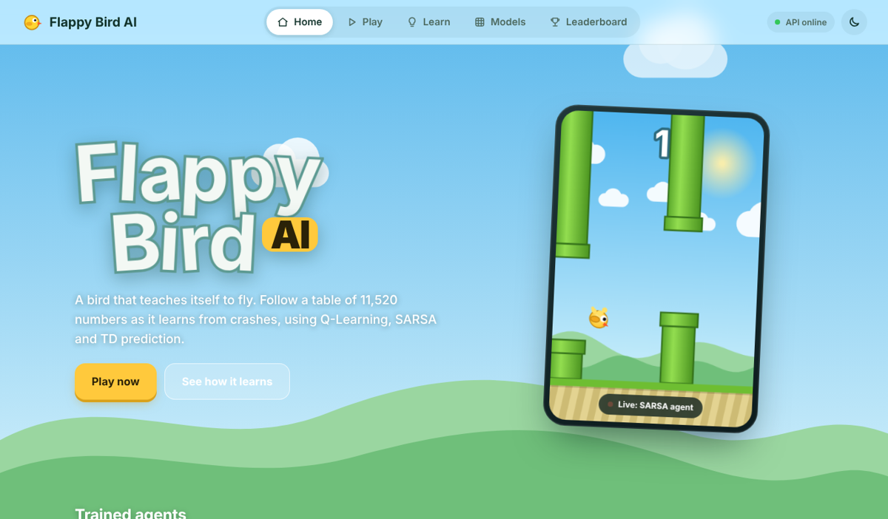
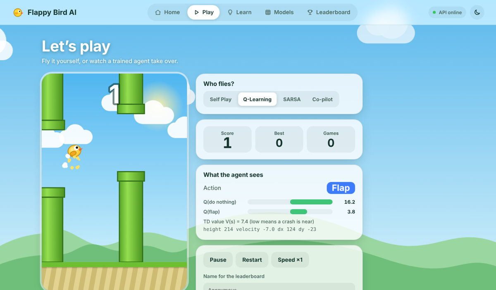
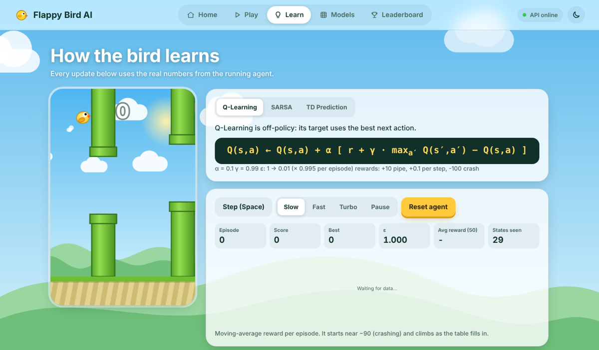
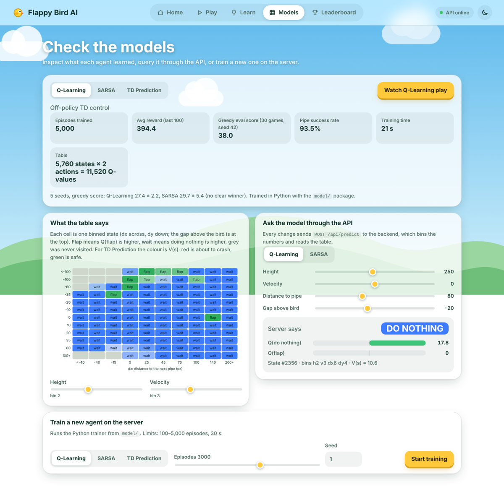
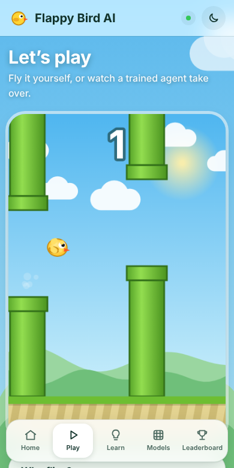

# Flappy Bird AI

[](https://github.com/YOUR-USERNAME/flappy-bird-ai/actions/workflows/ci.yml)


A Flappy Bird agent that teaches itself to fly with **Q-Learning**, **SARSA** and **TD prediction**.
Play it, watch it learn update by update, inspect the trained tables, and train new agents on the server.



| Play | How it learns |
|------|---------------|
|  |  |
| **Models** | **Mobile** |
|  |  |

## Quick start

```bash
python -m venv .venv && source .venv/bin/activate     # Windows: .venv\Scripts\activate
pip install -r requirements.txt
python run.py                                          # http://127.0.0.1:5000
```

Flask serves both the API (`/api/*`) and the static frontend, so there is nothing else to start and no build step.

## Project structure

```
flappy-bird-ai/
├── run.py                     dev entry point
├── requirements.txt
├── backend/                   Flask API
│   ├── app.py                 app factory (API + static frontend + JSON errors)
│   ├── config.py              paths, limits
│   ├── api/                   routes: system, models, training, scores
│   ├── services/              model_registry, training_service, score_store
│   └── data/                  scores.json is created here at runtime
├── model/                     everything about the agent (no web code)
│   ├── config.py              physics, state bins, hyper-parameters (single source of truth)
│   ├── environment.py         Flappy Bird environment (Python port of the browser one)
│   ├── agents.py              QLearning, Sarsa, TDPrediction
│   ├── evaluate.py            greedy evaluation
│   ├── train.py               CLI trainer
│   └── artifacts/             q_table.json, sarsa_table.json, td_values.json, metadata.json
├── frontend/                  plain ES modules, no bundler
│   ├── index.html
│   ├── css/                   tokens, base, layout, components, views, motion
│   └── js/
│       ├── main.js            boot: load config + models from the API, start router
│       ├── api/client.js      the only place that calls fetch()
│       ├── core/              router, store, dom helpers, charts, toast, loop
│       ├── game/              env, renderer, controller, learner
│       └── views/             home, play, learn, models, leaderboard
└── tests/                     unittest suites for model and API
```

## How the parts work together

| Step | What happens |
|------|--------------|
| Boot | The browser calls `GET /api/config` and `GET /api/models/<id>`. Physics, state bins and the Q-tables all come from `model/`, so the browser engine always matches the Python one. |
| Play | The game runs locally at 60 fps using the downloaded tables. Finished runs are saved with `POST /api/scores`. |
| Models | The inspector draws the tables, and *Ask the model* calls `POST /api/predict` so the server bins the state and returns the Q-values. |
| Train | `POST /api/train` runs the Python trainer from `model/agents.py` and returns the reward curve, an evaluation and the new table, which you can then watch play. |
| Learn | A JavaScript port of the learners shows every update with real numbers. |

## API

| Method | Path | Purpose |
|--------|------|---------|
| GET | `/api/health` | liveness check |
| GET | `/api/config` | physics, bins, hyper-parameters, rewards |
| GET | `/api/models` | metadata for all models |
| GET | `/api/models/<q\|s\|v>` | metadata and the full table |
| POST | `/api/predict` | `{model, features:{height,velocity,dx,dy}}` → action and Q-values |
| POST | `/api/train` | `{algo, episodes, seed}` → curve, evaluation, table (limited to 5,000 episodes / 30 s) |
| GET | `/api/scores?mode=&limit=` | leaderboard |
| POST | `/api/scores` | `{name, mode, score}` |

Errors are always JSON: `{"error": "...", "status": 400}`.

## Re-training the saved models

```bash
python -m model.train --algo all --episodes 5000          # overwrites model/artifacts/*.json
python -m model.train --algo q --episodes 3000 --dry-run  # train and report without saving
```

Restart the server afterwards. `model/artifacts/metadata.json` holds the human-readable results shown on the Models page; update it if you want the numbers to match a new run.

## Tests

```bash
python -m unittest discover -s tests -t .
```

## Production notes

- Run behind gunicorn: `gunicorn "backend.app:create_app()" -w 1 --threads 4`. Use one worker, because the leaderboard is a JSON file guarded by an in-process lock. Swap `ScoreStore` for a database to scale out.
- Hosting the frontend elsewhere: set `window.__API_BASE__ = "https://api.example.com"` before `js/main.js` loads, and `CORS_ORIGIN=https://your-site` on the backend.
- The leaderboard has input validation but no authentication, so scores can be forged by anyone who calls the API.

## Controls

Space or tap flaps, `P` pauses, `Esc` returns home. On the Learn page Space performs one learning step.

## License

MIT. See [LICENSE](LICENSE) and [CONTRIBUTING.md](CONTRIBUTING.md).
